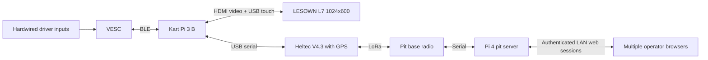

# Architecture and interface plan

This is the target design, not a deployed system. Framework and radio protocol
choices remain open pending hardware checks.

The diagram shows one kart; repeat it up to eight times. Kart-to-kart position
sharing can use direct reception or a pit fleet summary; choose after airtime
and coverage measurements. Neither path is currently implemented.

## Boundaries

| Component | Owns | Does not imply |
| --- | --- | --- |
| VESC | Hardwired throttle/reverse, motor control, configured protection | Automatic saved-profile restore after BLE loss |
| Kart Pi | UI, VESC connection, fleet cache, local logs/map | A functioning geofence after Pi/BLE failure |
| Heltec V4.3 + L76K | GPS and radio bridge | Working firmware or pin mapping based solely on photographs |
| Pit Pi 4 | Fleet/race state, authentication, command arbitration, radio session | An internet/cloud dependency |
| Browser | Operator interaction and live state | Direct ownership of the radio or authoritative command success |

## Proposed contracts

Use versioned records with explicit units, timestamp/age and validity. VESC
telemetry carries ERPM, currents, voltage, duty, temperatures and faults. GPS
records carry coordinates, fix state, age and available quality measures. Radio
records carry kart identity, sequence/session IDs and link quality.

The application model should keep source readings separate from derived MPH.
Configured wheel size/gearing/poles require physical verification. GPS speed
and driven-wheel speed are different during a drift; label the selected source.
Motor temperature is unavailable on the current hardware; never display raw 0 C
as a valid reading or invent it from ESC temperature.

The pit is the authority for race entry and operator commands. Multiple browsers
may control it; per-kart serialization, state revisions, command IDs and an audit
trail avoid racing/conflicting edits. Authentication is required; credentials
are deployment configuration, never committed defaults.

Radio commands need authentication, expiry, deduplication and per-recipient
outcomes. Acknowledging a packet is not proof that a VESC applied the setting.
Choose airtime/rate/payload together for eight karts and retain command capacity.

## Failure requirements

Pit/LoRa loss alone should allow normal driving. Mark remote positions stale.
Pi/BLE loss should restore the VESC's saved baseline, but this needs a verified
controller-side mechanism; no such mechanism is installed by this project.
Do not rely on a dead Pi to send a final command or on the motor-command timeout
to restore an entire configuration.

Future geofence enforcement must be local to survive pit loss. Enforcing it
through Pi/BLE after either fails needs a different independent control path.
The precedence between geofence state and saved-baseline fallback remains open
for that later feature. Remote stop is also deferred and would reduce propulsion
gradually; no active-braking behavior is approved or implemented.

## Map packaging

Store imagery locally with geographic transform/CRS and attribution. Store course
route, pits and future boundaries as separate geometry. The current site image
and actual course route are not yet supplied. Public CT ECO 2023 aerial imagery
is a candidate, not a downloaded asset. Do not transmit image tiles over LoRa.
