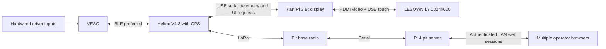

# Architecture and interface plan

This is the target design, not a deployed system. Framework and radio protocol
choices remain open pending hardware checks.

The diagram shows one kart; repeat it up to eight times. Kart-to-kart position
sharing can use direct reception or a pit fleet summary; choose after airtime
and coverage measurements. Neither path is currently implemented.

## Boundaries

| Component | Owns | Does not imply |
| --- | --- | --- |
| VESC | Hardwired throttle/reverse, motor control, configured protection | Automatic saved-profile restore after BLE loss |
| Kart Pi | Touchscreen rendering, map assets, presentation cache and UI requests | Ownership of the VESC link or control policy |
| Heltec V4.3 + L76K | VESC BLE client, telemetry, GPS, LoRa, validation/serialization of supervisory requests | Verified timing, automatic fallback or implemented profile writes |
| Pit Pi 4 | Fleet/race state, authentication, command arbitration, radio session | An internet/cloud dependency |
| Browser | Operator interaction and live state | Direct ownership of the radio or authoritative command success |

## Owner-approved ownership change

The Heltec is the kart supervisor; the kart Pi is the display/interface only.
The Pi must not open a competing normal-operation VESC session. Touchscreen
profile selections, when enabled later, are requests to the Heltec. The Heltec
validates and serializes local and pit requests and reports the actual outcome.
The VESC still executes its own motor-control loop and hardwired driver inputs;
the Heltec does not stream throttle, braking or torque commands in this design.
The pit Pi 4 retains its server and fleet-management responsibilities.

This separation is intended to isolate VESC communications from Linux/UI load.
It is not a measured latency improvement. BLE connection parameters, firmware
scheduling, GPS parsing and radio airtime still determine observed delays. Keep
BLE servicing independent of blocking LoRa sends and USB/display backpressure;
use bounded queues, source timestamps and watchdogs. A missing display must not
stall the Heltec. Measure sample-to-screen age and command-to-confirmation delay
under simultaneous BLE, GPS, LoRa and UI load before selecting update rates.

The board's ESP32-S3 supports Bluetooth LE; verify the installed VESC module's
GATT service and compatibility. BLE stays preferred. Direct wired UART is a
possible later alternative after connector, voltage, pin allocation and existing
BLE-module occupancy checks, not an approved wiring change. USB serial to the
Pi is proposed and needs V4.3 firmware/connector validation.

Provide a validated regulated supply for the Heltec independent of the display
Pi if it must survive Pi power loss. Do not rely solely on Pi USB power. Check
USB power/backfeed and reset behavior before combining supplies; exact wiring
remains unselected. Power-source isolation is not yet tested.

Hardware capability sources: [Heltec V4](https://heltec.org/project/wifi-lora-32-v4/),
[Espressif ESP32-S3](https://www.espressif.com/en/products/socs/esp32-s3).
Capability documentation does not establish this project's runtime performance.

## Proposed contracts

The [agreed telemetry scope and proposed field conventions](requirements.md#agreed-telemetry-fields)
are the starting point for the shared application model. Final wire encoding and
update rates remain open; telemetry approval does not imply a deployed interface.

Use versioned records with explicit units, timestamp/age and validity. VESC
telemetry carries ERPM, currents, voltage, duty, temperatures and faults. GPS
records carry coordinates, fix state, age and available quality measures. Radio
records carry kart identity, sequence/session IDs and link quality.

The application model should keep source readings separate from derived MPH.
Configured wheel size/gearing/poles require physical verification. GPS speed
and driven-wheel speed are different during a drift; label the selected source.
Motor temperature is unavailable on the current hardware; never display raw 0 C
as a valid reading or invent it from ESC temperature.

The pit is the authority for race entry and operator commands. Multiple browsers
may control it; per-kart serialization, state revisions, command IDs and an audit
trail avoid racing/conflicting edits. Authentication is required; credentials
are deployment configuration, never committed defaults.

Radio commands need authentication, expiry, deduplication and per-recipient
outcomes. Acknowledging a packet is not proof that a VESC applied the setting.
Choose airtime/rate/payload together for eight karts and retain command capacity.

## Failure requirements

Pit/LoRa loss alone should allow normal driving. Mark remote positions stale.
The earlier owner requirement to restore saved VESC settings on Pi failure is
retained: a healthy Heltec could detect loss of the display heartbeat and request
a verified restoration. This is a proposed mechanism; timeout/transition and
interaction with pit commands need design and testing. The display itself must
not be required to send a final restore message.

Heltec failure or loss of its VESC link is a separate case: restoration requires
verified VESC-resident support or another independent mechanism. A dead Heltec
cannot send a restore command. The ordinary motor-command timeout does not
restore an entire configuration. No fallback is currently implemented.

A future geofence can be evaluated on the Heltec using its GPS, independently of
the display and pit. It cannot guarantee enforcement after Heltec/VESC-link failure
without an independent control path.
The precedence between geofence state and saved-baseline fallback remains open
for that later feature. Remote stop is also deferred and would reduce propulsion
gradually; no active-braking behavior is approved or implemented.

## Map packaging

Store imagery locally with geographic transform/CRS and attribution. Store course
route, pits and future boundaries as separate geometry. The current site image
and actual course route are not yet supplied. Public CT ECO 2023 aerial imagery
is a candidate, not a downloaded asset. Do not transmit image tiles over LoRa.
